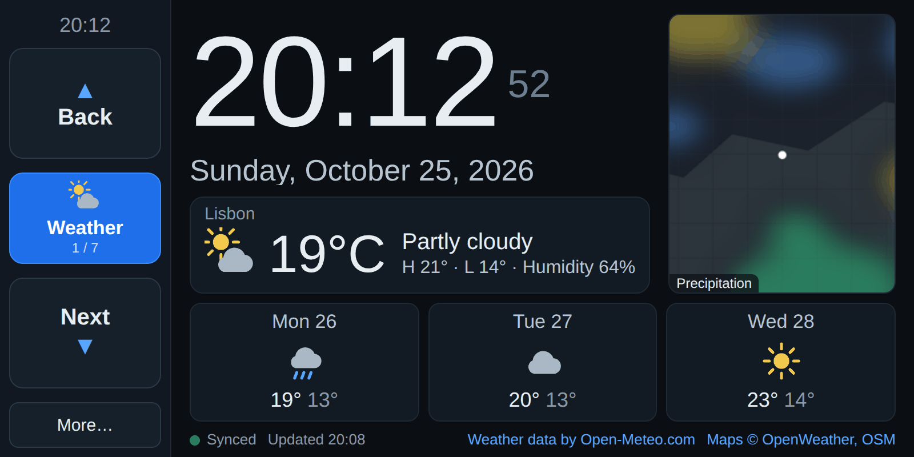
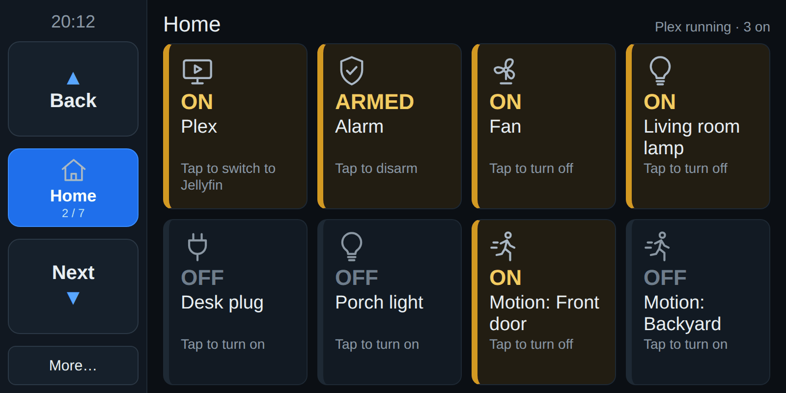
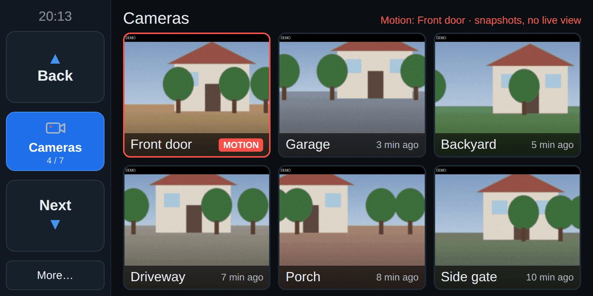
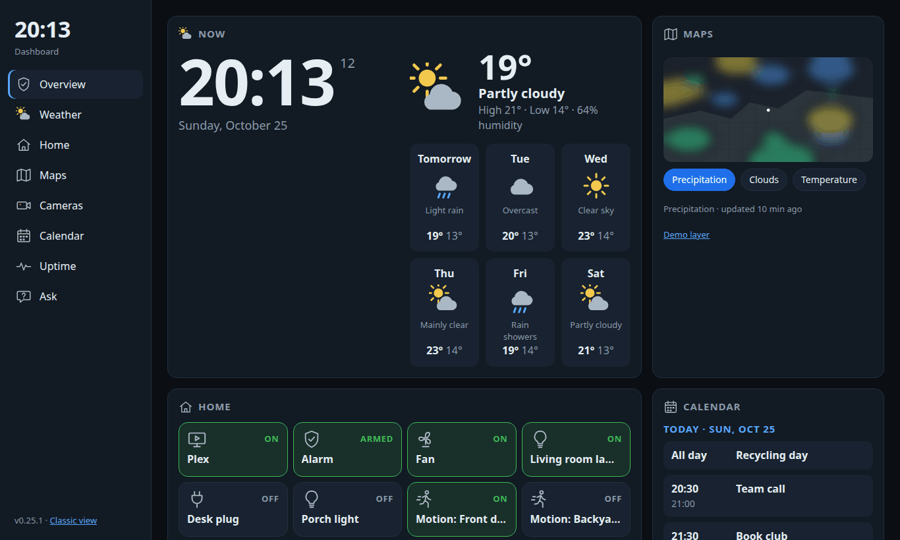
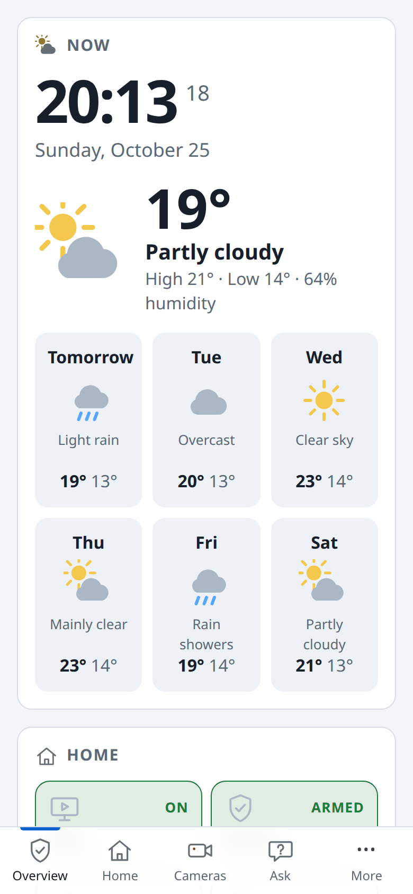

# Tablet Dashboard

[](https://github.com/daniellopezq/tablet-dashboard/actions/workflows/tests.yml)

**A self-hosted home dashboard for an Android 4.4 tablet (800 × 400, Chrome 50).** It combines clock, weather, maps, read-only calendar, an AI/voice assistant, service uptime, Home Assistant controls, and camera monitoring—including local RTSP live view.

The tablet runs plain ES5 JavaScript; a lightweight Python server handles APIs, caching, media conversion and private keys. Cloud AI and transcription can fall back to small local models when the cloud fails to respond. The goal is to make otherwise obsolete hardware useful without replacing it or depending on a modern browser.

**Current release:** [0.25.1](VERSION.md) (October 2026). The repository has **327 unittest tests**, run on every push by GitHub Actions; upstream services and camera processes are mocked in tests, and compatibility still needs real-device checks.

## Screenshots

The old tablet (800 × 400, Chrome 50) gets the classic ES5 page with big touch targets:

| Weather | Home | Cameras |
|---|---|---|
|  |  |  |

Phones and PCs get the modern view at the same address:

| PC (dark theme) | Phone |
|---|---|
|  |  |

*Screenshots use demo data: the location, events, devices, camera pictures and map layers are made up.*

## What it does

- **Clock:** synced to the server's time, so the tablet's own clock doesn't need to be right. Has a 12h/24h toggle.
- **Weather:** current conditions plus a short forecast, with automatic retries and a "stale" label when data is old.
- **Weather maps:** precipitation, cloud, wind and temperature layers over a darkened street map, rotating in a slideshow.
- **Calendar:** a read-only agenda of upcoming Google Calendar events.
- **Ask:** type or speak a question and get a short AI answer. Voice uses one tap and stops on its own when you stop talking.
- **Ask the house:** "turn off the fan", "¿qué está prendido?" or "what do you see outside?" in Spanish or English. Simple
  commands run without the AI; alarm-type actions need an on-screen Yes enforced by the server; answers can be spoken
  (local Piper voices, or Google Cloud TTS with Piper as the fallback).
- **Built for always-on use:** fullscreen mode, a diagnostics panel, usage limits so free API tiers aren't exceeded, and
  old data stays on screen when a service is down.
- **Local fallback:** when cloud AI or speech services provide no response before the configured deadline, llama.cpp and whisper.cpp can answer locally; the UI labels fallback results. An HTTP error response does **not** trigger fallback.
- **Admin page:** a password-protected, LAN-only page for API keys, AI models (cloud and local), Google sign-in, health checks
  and optional Uptime Kuma monitors, settings, logs and an offline test switch for trying the fallbacks.
- **Touch-friendly:** oversized Back/Next controls, large targets, and paged AI answers for a worn touchscreen.
- **Uptime:** Uptime Kuma and configured TCP/HTTP health monitors, with status, response times and a short history.
- **Home:** large Home Assistant tiles for lights, plugs, scripts and configured alarm actions, with current device state; optional Plex/Jellyfin switch.
- **Cameras:** Home Assistant camera snapshots and motion pop-ups (e.g. Blink), plus RTSP-to-MJPEG live viewing of local cameras (e.g. V380) through an on-demand FFmpeg process.
- **Automations:** a laundry check (rain coming → a pan/tilt camera looks at the clotheslines and warns if laundry is
  out) and an away mode (random, human-paced lights from sunset to a random bedtime). Read-only tiles can show any Home
  Assistant state, with a warning when it stays on too long (e.g. a garage door left open).
- **Modern view for phones and PCs:** the same address gives newer browsers a responsive page with every section: an
  Overview grid on a PC, a tab bar on a phone, light and dark themes, and one-tap voice. The old tablet keeps its
  lightweight page. The server picks the page from the browser's User-Agent.

## Why it's useful

- Reuses a tablet that would otherwise be e-waste.
- Self-hosted and LAN-only. API keys never reach the browser, and logs never store your questions, answers or audio.
- Light enough for 1 GB RAM devices, and a very old browser is enough.
- Every external service is optional. Each one stays off until you add its key.
- Local controls and RTSP cameras can keep working when the internet is unavailable; integrations that depend on a cloud provider (including some Home Assistant cameras) cannot.

### Engineering choices

The browser is a thin client: no frontend build, modern JavaScript syntax, or heavy map/video libraries. The server pre-renders map images, proxies camera stills without exposing Home Assistant credentials, and transcodes RTSP to MJPEG for old browser support. On the 2014-era host, measured benchmarks favored **CPU inference for Qwen3.5-2B** and **Vulkan GPU inference for Whisper base**; see [local AI benchmarks](docs/LOCAL-AI-BENCHMARKS.md). Services retain last-good data where possible, and fallback states are visible rather than silently treated as normal responses.

## Tools and services

| Area | Used |
|---|---|
| Server | Python 3.9+ standard library (`http.server`, `ssl`, `urllib`, `zoneinfo`); no frameworks |
| Front end | Plain HTML and CSS; ES5 JavaScript for the tablet, ES modules for phones and PCs; Web Audio, getUserMedia, MediaRecorder; no build step |
| Weather | [Open-Meteo](https://open-meteo.com/) Forecast API (no key) |
| Maps | [OpenWeatherMap](https://openweathermap.org/) tiles over [OpenStreetMap](https://www.openstreetmap.org/) base tiles, composited with Pillow |
| Calendar | Google Calendar API (read-only OAuth with PKCE) |
| AI assistant | [Vercel AI Gateway](https://vercel.com/docs/ai-gateway) (default model: Gemini 2.5 Flash-Lite) |
| Speech to text | [Groq](https://groq.com/) Whisper large-v3-turbo, with ffmpeg for audio conversion |
| Local fallback (optional) | [llama.cpp](https://github.com/ggml-org/llama.cpp) `llama-server` (default Qwen3.5-2B Q4_K_M) and [whisper.cpp](https://github.com/ggml-org/whisper.cpp) `whisper-server` (base), loopback only |
| Home and cameras (optional) | Your own [Home Assistant](https://www.home-assistant.io/) (REST API, long-lived token); RTSP cameras through ffmpeg (MJPEG for old browsers) |
| Uptime (optional) | Built-in TCP/HTTP checks; [Uptime Kuma](https://github.com/louislam/uptime-kuma) status page or `/metrics` |
| HTTPS | OpenSSL private CA, for microphone access on the LAN |
| Tests | `unittest` with mock servers for every upstream service (269 tests) |

## Quick start

```bash
git clone https://github.com/daniellopezq/tablet-dashboard.git && cd tablet-dashboard
cp config.example.json config.json   # set your timezone and weather location
python3 server.py --check            # validate the config
scripts/start.sh                     # runs in the background, log in logs/dashboard.log
```

Open `http://<server-ip>:8099/` on the tablet. Stop the server with `scripts/stop.sh`.

**Autostart (optional, since 0.18.0):** `scripts/install-autostart.sh` installs two systemd *user* services from
`deploy/systemd/` (`tablet-dashboard`, restarted 5 s after a crash, and `tablet-local-ai` for the optional local models)
and turns on lingering so they start at boot without a login. Use `--no-local-ai` to skip the models and `--remove` to go
back to manual start/stop. With the units installed, `start.sh` and `stop.sh` call `systemctl --user`. Status and logs:
`systemctl --user status tablet-dashboard`, `journalctl --user -u tablet-dashboard`. Since 0.29.0 it also installs the
`tablet-logrotate` timer: daily, it rotates `logs/*.log` with `deploy/logrotate/tablet-dashboard.conf` (weekly or at
20 MB, 8 compressed copies, `copytruncate`), with no root needed.

Optional features need extra setup and stay disabled or show a "not set up" message until you do it:

| Feature | Needs |
|---|---|
| Weather | Latitude and longitude in `config.json` (Open-Meteo, no key) |
| Weather maps | `OPENWEATHER_API_KEY` in `.env`, plus `python3-pil` |
| Calendar | A Google OAuth client and a one-time sign-in (see below) |
| Ask tab | `AI_GATEWAY_API_KEY` (Vercel AI Gateway) in `.env` |
| Voice input | `GROQ_API_KEY` in `.env`, `ffmpeg`, and https for one-tap recording |
| Admin page | https, and a password set with `scripts/set-admin-password.sh` |
| Local fallback | llama.cpp and whisper.cpp builds plus model files in a `local-ai/` folder next to this project (see "Local fallback") |
| Uptime Kuma | A Kuma instance; `base_url` plus a status page slug, or `KUMA_API` in `.env` |
| Home Assistant | A running Home Assistant instance, its `ha_url`, configured `home.buttons`, and `HA_TOKEN` stored in `.env` |
| Cameras | `cameras.list`; HA camera entities for snapshots, or local RTSP feeds and FFmpeg for live view; see the camera section |
| Away mode | Home Assistant lights listed under `away.lights`, and HA's `sun.sun` |
| Laundry check | An RTSP camera with ONVIF pan/tilt, a recorded movement recipe and reference pictures per clothesline (`laundry.lines`) |

## Layout

| Path | Purpose |
|---|---|
| `server.py` | Entry point: builds the services (`App`), runs the http and https listeners, holds `VERSION` |
| `config.py` | Config defaults, `config.json` loading and validation (each feature module validates its own section) |
| `httpcore.py` | HTTP helpers: content types, CSP, safe path resolution, Range requests, `send_json`/`send_file`, the LAN and same-origin checks |
| `routes/` | URL routing: the route table in `routes/__init__.py` (with a LAN-only flag per route), handlers in `public.py`, `ai.py`, `devices.py`, `files.py`, `admin_api.py` |
| `weather.py` | Open-Meteo weather: background fetcher and cache |
| `assistant.py` | AI assistant: request parsing, Vercel AI Gateway call, local fallback, house answers for Ask |
| `usage.py` | Usage limits for Ask and Voice (min interval, per hour, per day), persisted with a lock |
| `upstream.py` | Cloud calls: no redirects, bounded size and time, safe error categories |
| `util.py` | Tiny shared helpers (`num`, `now_ms`) |
| `voice.py` | Voice input: upload checks, ffmpeg conversion, Groq Whisper transcription, local fallback for Voice |
| `homeai.py` | "Ask the house": matcher for simple home commands, the house block for the model, actions with server-side confirmation, camera pictures |
| `tts.py` | Spoken answers: engine choice (Google or Piper), language pick (es/en), in-memory WAV cache, saved phrase bank |
| `googletts.py` | Optional Google Cloud Text-to-Speech: service-account sign-in, Chirp 3 HD voice, monthly character limit |
| `pgstore.py` | Optional history in a local PostgreSQL through `psql` (peer login): weather readings today |
| `fallback.py` | Local-fallback mechanism shared by Ask and Voice: header deadline, cooldown gate, local lock, plain-text cleaner |
| `maps.py` | Weather maps: OpenWeatherMap and OpenStreetMap tiles, rate limiting, Pillow compositing |
| `gcal.py` | Google Calendar: background fetcher and cache (`python3 gcal.py auth|status|test|revoke` still works) |
| `gcal_auth.py` | Google Calendar sign-in (OAuth with PKCE, used by the admin page) and the command line |
| `admin/` | Admin page backend: password sign-in, API keys, Calendar sign-in, settings, AI models, offline test, logs, maintenance (one mixin per page; CLI `python3 -m admin set-password`) |
| `health.py` | Health checks and the optional Uptime Kuma client (status page, `/metrics`, push heartbeat) |
| `localai.py` | Local model inventory, choice (`local_ai` in config) and start/stop for the admin page |
| `netsim.py` | Offline test switch (simulated internet outage inside the dashboard only) |
| `home.py` | Home Assistant controls (switch, two-service, read-only sensor), rate limits, current device states and optional Plex/Jellyfin switch |
| `cameras.py` | Home Assistant snapshots/motion, RTSP cameras, background snapshots, pan/tilt and day/night through `onvif.py` |
| `livefeed.py` | Live MJPEG for one camera stream: an on-demand FFmpeg and its latest frame |
| `laundry.py` | Laundry check: rain coming → the pan/tilt camera looks at the clotheslines |
| `away.py` | Away mode: random, human-paced lights from sunset to a random bedtime |
| `envfile.py` | Owner-only file helpers for `.env` and other private files, and API key loading |
| `config.example.json` | Example settings; copy to `config.json` (gitignored) |
| `.env` | **Private** API keys (mode 600; never served, gitignored) |
| `uidetect.py` | Picks the classic or modern page for `/` (User-Agent, `?ui=`, `ui` cookie) |
| `web/` | Classic tablet page and static files; its icons are shared with the modern view. `web/js/` is the ES5 client: one file per tab plus `core.js` (loaded first) and `main.js` (startup, last), sharing globals |
| `web-modern/` | Modern view for phones and PCs (ES modules, no build step), served under `/m/` |
| `media/` | Optional; the only directory served under `/media/` (mp4, m4v, webm) |
| `data/`, `logs/`, `run/` | Runtime state, log and PID file (created automatically, gitignored) |
| `scripts/` | `start.sh`, `stop.sh`, `make-cert.sh`, `set-assistant-key.sh`, `set-admin-password.sh`, `offline-test.sh`, `local-ai-start.sh`, `local-ai-stop.sh`, `install-piper.sh` (Piper and two voices into `../local-ai`, checksummed, no sudo) |
| `tools/eval_local_llm.py` | Quality and speed check for a local LLM |
| `docs/` | System overview, admin panel reference, local fallback architecture, benchmarks and plan |
| `tests/` | Unit tests with mock upstream servers: `python3 -m unittest discover -s tests`. `test_routes_table.py` compares every route against a recorded golden file |

## Configuration (`config.json`)

| Key | Default | Notes |
|---|---|---|
| `bind`, `port` | `0.0.0.0`, `8099` | |
| `https_port` | `null` | Optional https listener (see "Voice input") |
| `timezone` | `UTC` | Clock timezone (IANA name), independent of the server's own timezone |
| `clock_default_24h` | `true` | Default clock format. The 12h/24h button choice is remembered per browser. |
| `modern_dir` | `"web-modern"` | Folder for the phone/PC view, served under `/m/` |
| `ui.modern_enabled` | `true` | `false` sends every browser to the classic tablet page |
| `weather.latitude`, `weather.longitude` | `null` | **Set both to enable weather.** Decimal degrees. |
| `weather.label` | `""` | Place name shown above the current conditions |
| `weather.timezone` | `UTC` | Which calendar day the daily high/low and forecast use |
| `weather.temperature_unit` | `celsius` | `celsius` or `fahrenheit` |
| `weather.refresh_minutes` | `15` | Minimum 5 |
| `weather.stale_after_minutes` | `35` | Older data is marked stale |
| `assistant.*`, `voice.*`, `maps.*`, `calendar.*` | | See the sections below |
| `local_ai.*`, `health.*`, `kuma.*`, `admin.*` | | See "Local fallback" and "Admin page"; full tables in [docs/ADMIN-PANEL.md](docs/ADMIN-PANEL.md) |
| `home.*`, `cameras.*` | | Optional Home Assistant, local device control and camera definitions; see the Home and Cameras sections |
| `tts.*` | | Spoken Ask answers (Piper or Google); see "Ask the house" |
| `database.enabled` | `false` | Optional weather history in a local PostgreSQL; see "Weather history" |

The weather location is never guessed from the timezone or IP address. Keys starting with `_` are ignored, so you can use
them for comments. Restart after editing: `scripts/stop.sh && scripts/start.sh`.

## API keys (`.env`)

Keys live only in `.env` next to `server.py`, never in `config.json` or `web/`. Store one without it showing on screen or in
shell history:

```bash
scripts/set-assistant-key.sh                               # AI_GATEWAY_API_KEY
KEY_NAME=GROQ_API_KEY scripts/set-assistant-key.sh         # voice
KEY_NAME=OPENWEATHER_API_KEY scripts/set-assistant-key.sh  # maps
scripts/set-assistant-key.sh --remove                      # delete a key (KEY_NAME applies here too)
```

The admin page's **API keys** page does the same in the browser: save, replace, remove and test `AI_GATEWAY_API_KEY`,
`GROQ_API_KEY`, `OPENWEATHER_API_KEY`, `GOOGLE_CLIENT_ID`/`GOOGLE_CLIENT_SECRET`, `KUMA_API`, `KUMA_PUSH_URL` and `HA_TOKEN`
(`BLINK_PROXY_TOKEN`, for the optional Blink live view, is not on that page yet: add it to `.env` yourself). It never
shows a stored value, only the last 4 characters, and changes apply without a restart.

The server refuses to use a `.env` that is group- or world-readable, a symlink, or owned by another user. Environment
variables with the same names take priority over the file.

## HTTP routes

| Route | Behaviour |
|---|---|
| `/` | Classic page (`web/index.html`) or modern page (`web-modern/index.html`), chosen by `?ui=`, the `ui` cookie, then the User-Agent. See "Modern view and browser detection". |
| `/m/<file>` | Modern view files from `web-modern/`, with the same rules as `web/`. |
| static files | Only from `web/`; html, css, js, svg, png, ico, txt and crt. No directory listings. Dotfiles, `..`, encoded traversal, backslashes, NUL bytes and symlinks leaving `web/` return 404. |
| `/api/time` | Server time, timezone and UTC offset; never cached |
| `/api/weather` | Cached weather plus status (`unconfigured`, `loading`, `error`, `ok`) and a `stale` flag. Never contacts Open-Meteo during the request. |
| `/api/calendar` | Cached agenda grouped by day, plus status. LAN clients only. |
| `/api/uptime` | Uptime Kuma monitors, then the `health.targets` services: names, states, ping, uptime % and recent history only (no hosts or URLs). LAN clients only. |
| `/api/home` | Home tab buttons with live state (HA entity states, which media server runs, whether a switch is in progress; for read-only tiles also `since_ms` and `warn`). LAN clients only. |
| `POST /api/home/action` | Press one button (`{"id": "..."}`). Same-origin, LAN clients only, 2 s debounce per button. |
| `/api/cameras` | Camera list (label, availability, image version and time, motion, battery, live), the current motion `alert`, and the laundry check's status (`laundry`: lines, last result, warning). LAN clients only. |
| `POST /api/laundry/check` | Look at the clotheslines now, whatever the weather (`{}`). 409 while a check runs. Same-origin, LAN only. |
| `/api/cameras/<id>.jpg?v=<version>` | Latest still of one camera (from HA by the server, so the token never reaches the tablet, or from the RTSP feed). LAN clients only. |
| `/api/cameras/<id>/live.mjpg` | Live view of an RTSP camera as MJPEG (`multipart/x-mixed-replace`) for an ``; ends after `live_max_seconds`. At most 4 viewers per camera. LAN clients only. |
| `/api/cameras/<id>/live.mjpg?q=hd` | The same from the camera's HD stream (`rtsp_url_hd`), if it has one. |
| `/api/cameras/<id>/controls` | What a camera's page can offer (`hd`, `ptz`, `day_night`) and its current day/night `mode`, read from the camera. LAN only. |
| `POST /api/cameras/control` | One pan/tilt step (`{"id": "...", "move": "left\|right\|up\|down"}`) or a day/night change (`{"id": "...", "mode": "day\|night\|auto"}`) over ONVIF. Same-origin, LAN only. |
| `POST /api/cameras/snapshot` | Ask one HA camera for a new picture (`{"id": "..."}`); wakes battery cameras, so rate limited. Same-origin, LAN only. |
| `/api/config` | Client settings (version, timezone, clock format, weather unit, https port) |
| `POST /api/assistant`, `/api/assistant/status` | Ask a question or give a home command; setup state, remaining quota and spoken-answer status |
| `POST /api/assistant/confirm` | Carry out a home action the assistant held back for confirmation (one-time token, 60 s). Same-origin, LAN only. |
| `/api/tts/<speech_id>.wav` | The spoken answer for one reply (saved phrase bank or Piper/Google). LAN only. |
| `POST /api/transcribe`, `/api/voice/status` | Speech to text; setup state and remaining quota |
| `/api/maps`, `/maps/<layer>.png`, `/maps/<layer>_small.png` | Map status and rendered images |
| `/media/<file>` | Only from `media/`, with byte-range support |
| `/admin`, `/api/admin/*` | Admin page and its JSON API: **https listener and LAN clients only** (404 otherwise). See "Admin page". |

Only GET and HEAD are accepted, apart from the POST routes above. Idle connections time out after 20 s.

## Modern view and browser detection

Old browsers like the tablet's Chrome 50 need the classic ES5 page in `web/`. Phones and PCs get a newer page from
`web-modern/` at the same address. It's built with plain ES modules: no build step, no framework, and nothing loaded
from the internet. Both pages use the same `/api/*` routes, so the LAN-only rules apply unchanged.

`uidetect.py` decides what `GET /` sends. The first rule that matches wins:

1. `?ui=classic` or `?ui=modern` picks a view and remembers it for a year (`ui` cookie). Add `&once=1` to pick it for
   this visit only. `?ui=auto` forgets the choice.
2. A `ui` cookie, if one is set.
3. The User-Agent. The classic view goes to Chrome/Chromium below 80, Firefox below 78, Safari or iOS below 14, and IE.
   Everything else, including unknown browsers, gets the modern view.

A browser that gets the modern page but can't run it falls back to the classic one by itself. Without ES modules it
runs `fallback.js`; if `app.js` fails to load, `boot.js` catches that. `/index.html` is always the classic page.
`"ui": {"modern_enabled": false}` in `config.json` sends everyone to the classic view.

| Screen | Layout |
|---|---|
| PC (900 px and wider) | Sidebar plus an Overview grid: clock and weather, Home tiles, the rotating map, camera thumbnails, upcoming events, uptime, Ask |
| Phone | Bottom tab bar: Overview, Home, Cameras, Ask, More (Weather, Maps, Calendar, Uptime) |

Every section is available. Cameras have their own pages (`#cameras/<id>`): live MJPEG for RTSP cameras, **New
snapshot** for Home Assistant ones. A motion alert shows a banner with a **View** link instead of jumping to the camera
the way the tablet does. Home buttons ask for confirmation exactly like the tablet. Since 0.29.0 the Cameras page has a
**Clotheslines** panel (last result per line, **Check now**), a laundry warning or a read-only tile's warning shows as an
amber banner on every screen until dismissed, and Weather (plus its Overview card) shows the rain chance for the next
12 hours.

Voice uses `MediaRecorder` and stops by itself after a pause, with the same thresholds as the tablet. Browsers only
allow the microphone on secure pages, so use the https address (`https://<server>:<https_port>/`). On plain http,
**Voice** takes you to the https address, where one tap records (since 0.22.1). The theme follows the device's light
or dark setting. The 12/24 h choice (tap the clock) is shared with the classic view on the same device.

## Client behaviour

- **Clock:** driven by server time, so the tablet's own clock and timezone don't need to be right. Each sync corrects for
  half the round-trip time; the display then advances locally. Syncs run every 60 s, every 15 s after a failure, and
  whenever the page becomes visible or the local clock jumps. The footer shows sync status (green, amber or red).
- **Weather:** the server fetches Open-Meteo every 15 min and backs off after failures (1, 2, 4, 8 min). It keeps the last
  good data, which the page marks "Stale".
- **Navigation:** the left rail has big **Back** / **Next** buttons that step through Weather, Home, Maps, Cameras,
  Calendar, Uptime and Ask (wrapping around), with the current section name between them. Tapping the name opens a full-screen grid to jump to
  any section. **More…** holds 12h/24h, Info and Fullscreen as big buttons. Taps in the first 300 ms after a panel opens
  are ignored, for poor touchscreens.
- **Uptime:** Uptime Kuma monitors first, then the services under `health.targets` in `config.json`, 4 cards per page
  with Back/Next. Anything down sorts to the front of its group. Each card shows the state, response time, uptime %
  over the dashboard's own check history (up to 24 h, kept in memory) and the last 30 checks. It polls every 30 s while
  the tab is open.
- **Fullscreen:** in the More panel. If the browser has no fullscreen API, the button is dimmed.
- **Diagnostics:** the Info button shows user agent, viewport, pixel ratio, sync round-trip, clock error and more.
- **Offline test tag:** while the admin page's offline test switch is on, a red **OFFLINE TEST** tag shows in the rail.
- Tabs can be bookmarked directly, e.g. `http://<server-ip>:8099/#assistant`.

## AI assistant (Ask tab)

With `assistant.home_control` off, each question starts fresh: only a short system instruction and the question go to
the model, with no history or access to the house. With it on (the default since 0.22.0), see "Ask the house" below.
There is no web search and no access to weather, calendar or the server. Answers are plain text in large type, paged instead of scrolled: when an answer
doesn't fit, big Back and Next buttons appear beside it. The Voice button is a large target next to the question box.

- **Provider:** [Vercel AI Gateway](https://vercel.com/docs/ai-gateway), OpenAI-compatible
  `POST https://ai-gateway.vercel.sh/v1/chat/completions`, default model `google/gemini-2.5-flash-lite`
  (`assistant.model`). It's called with the standard library; no SDK.
- **Request:** `max_tokens` 300, no streaming, `reasoning: {"effort": "none"}` (set `assistant.disable_thinking` to `false`
  to omit it). Upstream requests are never retried automatically.
- **Limits** (global, under `assistant`):

  | Setting | Default | Meaning |
  |---|---|---|
  | `min_interval_seconds` | 10 | Minimum gap between questions |
  | `max_per_hour` | 20 | Rolling 60 minutes |
  | `max_per_day` | 100 | Per calendar day in the configured timezone |
  | `max_question_chars` | 1000 | Longer questions are rejected before using quota |
  | `max_output_tokens` | 300 | Cap on answer length |
  | `timeout_seconds`, `max_response_bytes` | 30, 65536 | Bounds on the upstream call |
  | `quota_block_minutes` | 60 | Pause after the provider reports no credits (402) or refused access (403) |

- Only one upstream request runs at a time. Every request that reaches the provider counts, even if it fails. Counters
  persist in `data/assistant-state.json`, so restarts don't reset them.
- `data/assistant-usage.jsonl` records time, model, outcome, status, duration and token counts. **It never contains
  questions, answers or keys.** Set `price_per_million_input_usd` and `price_per_million_output_usd` to get cost estimates.

### Security

- Same-origin only. Requests are refused if they have a foreign `Origin`, a `Sec-Fetch-Site` other than same-origin, the
  wrong `Content-Type`, or a `Host` that isn't an IP address, `localhost` or one of `assistant.allowed_hosts`. The Host
  check blocks DNS rebinding. Add your server's hostname to `allowed_hosts` if you open the dashboard by name. No CORS
  headers are sent.
- Only private-network and loopback clients are served. Provider redirects are never followed, so keys can't be forwarded
  elsewhere. Upstream error text is never shown to the browser or logged.
- Logs contain the request line and status only, never question or answer content.
- **Don't expose this server to the internet.** It's designed for a trusted LAN.

## Ask the house (0.22.0)

The Ask tab (typed or by voice) also controls the Home tiles, answers questions about the house and looks through the
cameras, and the answer can be spoken. `homeai.py` does the house part; the model never gets more than the list below.

- **Simple commands without the AI** (no Ask quota): "apaga el abanico", "prende la luz de la recámara principal",
  "turn off the fan", "arma la alarma", "cambia a jellyfin", "apaga el abanico y el govee", and state questions such as
  "¿qué está prendido?" or "is the alarm armed?". Names come from each button's `label`, `id` and optional
  `aliases` (a list in `config.json`, e.g. `["ventilador", "fan"]`); accents and filler words are ignored.
- **Everything else goes to the model** with a HOUSE block (button ids, names and current on/off states; camera ids and
  names; no entity ids or addresses) and answers as JSON `{"say", "actions", "look"}`. Ids that aren't Home tiles are
  dropped. Offline, the local Qwen model gets the same block (grammar-constrained JSON).
- **Never toggles blindly:** "apaga" on a light that is already off does nothing and says so (`Home.set_state`).
- **Offers are never carried out:** when the model's reply asks ("¿quieres que apague…?"), any actions it listed are held
  for the same Yes/No as below instead of running (0.22.4).
- **Confirmation is enforced on the server:** buttons with `"confirm": true` (alarm, media switch) are never pressed by
  the assistant. The reply carries a one-time token; the page shows the same Yes/No dialog as the Home tab, and only
  `POST /api/assistant/confirm` presses the button.
- **Memory:** the page sends a random conversation id; the server keeps the last `assistant.memory_turns` (6) messages
  for `assistant.memory_seconds` (120 s) idle, in memory only, so "and the fan too" or "¿y sigue ahí?" work. Clear starts a
  new conversation.
- **Cameras:** "¿qué ves en la calle?", "is anyone in the living room?". RTSP cameras give a live frame (HD feed when they have
  one); Home Assistant cameras give their Home Assistant snapshot, refreshed first when older than
  `assistant.look_max_age_seconds` (60 s). Cameras with `"ai_refresh_seconds": 60` (best for cameras on
  mains power; leave battery cameras on demand) get a background "New snapshot" every minute (`cameras.ai_refresh_enabled`
  turns it off; backs off up to 10 minutes on errors). The picture is shrunk to at most 1024 px and sent with the
  question to the cloud model; it counts as one Ask question. **Images are never sent to the local model:** offline,
  the answer says the internet is needed.
- **Spoken answers (Piper):** `scripts/install-piper.sh` installs Piper and two voices (es_MX "claude" high quality,
  en_US "lessac", ~60 MB each) into `../local-ai/`. The voice is picked from the answer's language. The reply has a `speech_id`; the page
  fetches `/api/tts/<id>.wav` (about 0.7 s per sentence on a 2014 Core i3) and plays it through Web Audio, unlocked by the
  Ask/Voice tap (Android Chrome only plays sound after a tap). A "Sound on/off" button next to Clear remembers the choice.
  Config section `tts` (`enabled`, `binary`, `voices`, `length_scale_es` 0.85 and `length_scale_en` 1.0 for speaking
  speed, `sentence_silence`, `max_chars`, `timeout_seconds`, `cache_items`, `phrase_bank`, `phrases_extra`); speeds
  and the phrase bank switch are also on the admin page.
- **Google voice (0.25.0):** with `tts.engine` set to `"google"`, answers are spoken by Google Cloud
  Text-to-Speech (`googletts.py`, voice `es-US-Chirp3-HD-Achernar` / `en-US-Chirp3-HD-Achernar`), and Piper is the
  fallback. Set-up: create a service account in a Google Cloud project that has the Text-to-Speech API and
  billing enabled (the service account needs no role), add a JSON key, and save it as `data/google-tts-sa.json`
  with mode 600. Characters are counted per month in `data/google-tts-usage.json`, and Google is not used past
  `tts.google_monthly_chars` (500,000; the free tier is 1M). Other settings: `google_voice_es/en`,
  `google_speaking_rate_es/en`, `google_timeout_seconds`, `google_key_file`. Needs `python3-cryptography`
  (Ubuntu package).
- **Saved phrase bank (0.24.0):** every fixed reply to a home command, for each Home button in Spanish and English
  ("Abanico apagado.", "Abanico ya estaba apagado.", "¿Apagar Abanico? Confírmalo en la pantalla.", "Todo está
  apagado.") plus `tts.phrases_extra`, is rendered once in the background into `data/tts-phrases/` and played from
  there at once. A reply made of several saved sentences is joined from the saved clips. File names hash the engine,
  voice, speed and text, so a speed change re-renders the clips and old ones are removed. AI answers are never written
  to disk; they still go through Piper. Progress is in `/api/assistant/status` (`speech.phrases`).
- **Privacy:** with `assistant.home_control` on, button names and on/off states go to the cloud model with questions
  the matcher doesn't handle, and a camera picture goes only when someone asks about a camera. Turn it off on the
  admin page (Settings, Ask) to get the plain assistant back.

## Voice input (Voice button on the Ask tab)

Speech becomes the question text, transcribed by **Groq** `whisper-large-v3-turbo`.

- **One tap (needs https):** browsers only allow microphone access on secure origins. Run `scripts/make-cert.sh` (or
  `DASHBOARD_IP=<ip> scripts/make-cert.sh`), which creates a private CA and server certificate in `data/tls/`. Then set
  `"https_port": 8443` and restart. Open `https://<server-ip>:8443/`, accept the certificate warning once, and allow the
  microphone. The page records with getUserMedia and Web Audio, so it works on Chrome 50 without MediaRecorder. It stops
  about 1.3 s after you stop talking (30 s maximum), sends nothing if it hears nothing for 7 s, and with `voice.auto_ask`
  on asks the question automatically.
- **Removing the warning (optional):** the CA's public certificate is served at `/dashboard-ca.crt`. On Android, install it
  with Settings → Security → Install from storage. Android 4.4 then requires a screen-lock PIN.
- **Fallback over plain http:** Voice opens the system recorder or file chooser and uploads the recording.
- **Server side:** `POST /api/transcribe` takes up to 8 MiB. It checks the format by content (wav, mp3/aac, m4a/mp4/3gp,
  ogg, webm, flac, amr) and converts it with ffmpeg to 16 kHz mono WAV, trimmed to 30 s. Temporary files are deleted
  immediately.
- **Limits** (under `voice`): 5 s between recordings, 60 per hour, 300 per day, one at a time. Groq bills every request as
  at least 10 s of audio. `data/voice-usage.jsonl` never holds audio, transcripts or keys.
- Transcripts that are empty, only punctuation, or likely non-speech are reported as "didn't catch any speech".

## Admin page

`https://<server-ip>:8443/admin`, from a PC or phone on the LAN. It's served **only on the https listener and only to LAN
clients**; on http and from outside the LAN, `/admin` and `/api/admin/*` return 404. Internals (API, security model, config
sections): [docs/ADMIN-PANEL.md](docs/ADMIN-PANEL.md).

**First time:** on the server run `scripts/set-admin-password.sh` (at least 10 characters, typed with echo off). Only a
scrypt hash is stored, in `data/admin.json` (mode 600). Run it again to change the password.

**Sign-in:** one admin, one password. Sessions live in server memory (cookie `HttpOnly; Secure; SameSite=Strict`) and end
after 8 h idle, 7 days at most, on sign-out, or when the server restarts. Five wrong passwords from one address lock sign-in
for 15 minutes. Every POST must carry `X-Admin: 1`, a same-origin `Origin`/`Host` and a JSON body.

| Page | What it does |
|---|---|
| Overview | Version, uptime, disk, memory, certificate expiry, a line per service |
| API keys | Save, replace, remove and **test** each key. Write-only: shows "set" and the last 4 characters, never the value. Applies without a restart. |
| AI models | Per service (Ask, Voice): cloud model (with the provider's model list), token limit, fallback on/off, no-response deadline, cooldown, local time limit, applied **live**. Local models: pick the chat and speech model files and builds (`cpu`/`vulkan`) found under `local-ai/`, threads; Start/Stop/Restart; memory and health; test buttons. Models larger than the free memory are refused. |
| Offline test | See below. |
| Google Calendar | Connect / Reconnect / Revoke. The final sign-in page (`http://127.0.0.1:<port>/…`) fails to load on another computer, so paste its address into the page. Shows the token's age and, while your Cloud app is in Testing, the 7-day expiry. |
| Health & uptime | Built-in checks every 60 s (listeners, data freshness, keys, Google sign-in age, local models, disk, certificate, offline switch), TCP/HTTP checks of `health.targets` (other services on your network), and Uptime Kuma monitors. About 24 h of history per check, in memory. |
| Settings | Form editor for the safe parts of `config.json`. The old file is copied to `backups/config-<time>.json` first and the result is validated like at start-up. Fields marked ↻ need a restart (button provided); the rest apply immediately. |
| Logs & usage | Ask/Voice requests, local and simulated answers, cost and tokens for today and this month; tails of the server and local-model logs. |
| Maintenance | Refresh now, rebuild maps, clear the assistant's quota pause, back up code and config to `backups/` (no `.env`, no `data/`), restart the dashboard. |

### Offline test switch

Makes the **dashboard process only** behave as if the internet were down, to test the local fallbacks and the stale-data
display. Nothing else on the server loses its network; no firewall rules are touched.

- Choose services: `ask`, `voice` (cloud AI calls) and optionally `weather`, `maps`, `calendar`.
- **Realistic** mode (default): cloud AI requests hang like a black-holed connection, so the real 5 s no-response deadline,
  the straggler guard and the 60 s cooldown-then-probe run as in an outage. **Instant** mode fails at once.
- It always switches itself off (default 15 min, at most 120). Turning it off resets the cooldowns so the cloud is used again
  immediately.
- While it's on, the admin page shows a red banner, the tablet shows a red **OFFLINE TEST** tag, and usage-log entries carry
  `"simulated": true`.
- **Fallback test** sends one question through Ask and a sample recording through Voice and shows which side answered.
- Terminal: `scripts/offline-test.sh on ask,voice 10` · `scripts/offline-test.sh on ask 5 instant` ·
  `scripts/offline-test.sh off` · `scripts/offline-test.sh status`.

### Uptime Kuma (optional)

Show the monitors of an [Uptime Kuma](https://github.com/louislam/uptime-kuma) instance (for example, your web servers) on
the Health page. In Settings → Uptime Kuma (or `config.json` → `kuma`), set `base_url` (e.g. `http://192.168.1.10:3001`)
and either `status_page_slug` (a public status page; no key needed) or `use_metrics: true` with `KUMA_API` saved on the API
keys page (reads `/metrics`: all monitors, no uptime percentages). Then turn on `enabled`. With `push_enabled` and
`KUMA_PUSH_URL` (a Kuma *Push* monitor URL), the dashboard sends a heartbeat after every check, so Kuma can alert you when
the dashboard itself stops.

## Local fallback (offline models for Ask and Voice)

When the cloud APIs don't respond, small models on the server answer instead, and the page labels those answers **Local
fallback (small model, may be wrong)**. Details: [docs/LOCAL-FALLBACK-ARCHITECTURE.md](docs/LOCAL-FALLBACK-ARCHITECTURE.md)
(design, configuration, operations) and [docs/LOCAL-AI-BENCHMARKS.md](docs/LOCAL-AI-BENCHMARKS.md) (measurements on a 2014
dual-core i3 with a GTX 745).

- **When it falls back:** **only** when no HTTP response headers arrive within 5 s, or the connection fails. Any HTTP status
  (401/402/403/429/5xx) keeps the normal error, so billing and quota problems stay visible. After a no-response, that
  service skips the cloud for 60 s, then one request probes it.
- **Chat:** `llama-server` on 127.0.0.1:8091 (default Qwen3.5-2B Q4_K_M, CPU, 2 threads, about 2 GB RAM).
- **Voice:** `whisper-server` on 127.0.0.1:8092 (default whisper base; Vulkan GPU if available).
- **Setup:** build llama.cpp and whisper.cpp into `local-ai/build/llama-<cpu|vulkan>/` and `local-ai/build/whisper-<cpu|vulkan>/`,
  and put model files in `local-ai/models/`, where `local-ai/` is next to this project (or set `LOCAL_AI_DIR`). The
  architecture doc has the exact build commands and pinned versions.
- **Commands:** `scripts/local-ai-start.sh` / `scripts/local-ai-stop.sh`. `scripts/start.sh` runs the start script unless
  `NO_LOCAL_AI=1`, and the dashboard works without it. `python3 tools/eval_local_llm.py` runs a quality check.
- **Settings:** `fallback_*`, `no_response_seconds` and `cloud_cooldown_seconds` in the `assistant` and `voice` sections; the
  model and backend choice in `local_ai`. The admin page edits all of these.

## Weather maps (Maps tab and Weather tab card)

A background thread builds map images; requests only read finished files.

1. Fetch OpenWeatherMap tiles for each layer around the weather location.
2. Composite them over an OpenStreetMap base map (fetched once, cached in `data/maps/base/`), darkened to `base_brightness`.
3. Boost contrast and saturation (handy for washed-out tablet LCDs), draw a location marker, and write a 1024×512 image for
   the Maps tab and a 512×256 crop for the Weather tab.

Both views rotate through the layers with a crossfade and only poll while visible.

| Key (`maps`) | Default | Notes |
|---|---|---|
| `enabled` | `true` | |
| `layers` | `precipitation_new`, `clouds_new`, `wind_new`, `temp_new` | `pressure_new` also allowed |
| `zoom` | `13` | 3–13. At 11 the large image covers about 65 × 32 km |
| `width`, `height` | `1024`, `512` | Tile count grows with size, not zoom |
| `refresh_minutes` | `30` | Minimum 10 |
| `max_calls_per_minute` | `30` | OpenWeather free plan allows 60 |
| `rotate_seconds` | `10` | Slideshow interval |
| `base_brightness`, `overlay_opacity` | `0.4`, `1.0` | 0–1 |
| `contrast`, `saturation` | `1.35`, `1.4` | 0.5–3 |

About 15 tiles per layer means roughly 60 calls per refresh and 2,900 a day at 30 min intervals. If the key is rejected
(401/403) or rate-limited (429), the cycle stops and backs off; old images stay up, marked stale. New OpenWeather keys can
take up to about 2 hours to activate.

**Attribution** ("Weather maps © OpenWeather", "Map © OpenStreetMap contributors") is shown on screen. Keep it, and follow
the [OSM tile usage policy](https://operations.osmfoundation.org/policies/tiles/).

## Google Calendar (read-only)

Uses scope `calendar.events.readonly` with your own OAuth client.

1. In Google Cloud Console, create a project, enable the **Google Calendar API**, and configure the OAuth consent screen
   (External). Complete the Branding page, then **publish the app to "In production"**. Apps left in Testing get refresh
   tokens that expire after 7 days. An unverified app is fine for personal use.
2. Create an OAuth client of type **Desktop app**. Put `GOOGLE_CLIENT_ID` and `GOOGLE_CLIENT_SECRET` in `.env`.
3. Sign in once: `python3 gcal.py auth` (optionally `--login-hint=you@example.com`). This uses a loopback redirect with PKCE.
   If your browser is on another machine, paste the final redirect URL back into the terminal.
4. Check with `python3 gcal.py status` and `python3 gcal.py test`. Sign out with `python3 gcal.py revoke`.

Steps 3 and 4 can also be done from the admin page's **Google Calendar** page.

The refresh token is stored in `data/gcal-token.json` (mode 600). Settings live under `calendar`: `calendar_ids`
(default `["primary"]`) and `days_ahead`.

## Home tab (Home Assistant buttons)

Optional; bring your own [Home Assistant](https://www.home-assistant.io/). One large tile per button in `config.json` →
`home.buttons`, 8 per page. Create a long-lived token in HA (your profile → Security) and save it as `HA_TOKEN` in `.env`
(or on the admin page: API keys → Home Assistant token, with a Test button). Set `home.ha_url` if HA isn't at
`http://127.0.0.1:8123`.

- **`ha`** buttons call a Home Assistant service, e.g. `{"service": "light.toggle", "entity_id": "light.lamp",
  "state_entity": "light.lamp"}`. With `state_entity` the tile shows ON/OFF; a tap flips it at once and the next poll
  confirms. Put routines in HA (scripts, scenes) and point a button at `script.turn_on`.
- **Two-service buttons:** instead of `service`, use `on_service` + `off_service` with `state_entity`; the server picks one
  by the current state (e.g. arm/disarm an alarm panel; tiles show ARMED / OFF). `"confirm": true` asks first.
- **`media_switch`** (optional, advanced) runs exactly one of Plex or Jellyfin. It calls your own root-owned
  `/usr/local/sbin/media-switch <plex|jellyfin>` through `sudo -n`, so you need to write that script and a sudoers rule
  allowing only it for the dashboard's user. Leave it out of `home.buttons` if you don't want it.
- **`away`**: the away mode switch (see "Away mode").
- **`sensor`** (0.30.0): a read-only tile for `state_entity`. Optional `words` (`{"on": "Open", "off": "Closed"}`) for the
  tile, `words_es` for the assistant's answers, and `warn_minutes`: once it has been on that long the tile turns amber and
  a banner shows on every tab (tablet and modern view) until tapped. A tap only says it's read-only, and the assistant can
  report it but never switch it.

**Example: a garage door from phone notifications.** Some garage openers (MyQ, for one) no longer allow third-party
integrations, but their phone app still sends "opened"/"closed" notifications. The Home Assistant Android app can report
them: turn on its "Last notification" sensor and set its allow list to the opener's app only. An HA automation then turns
an `input_boolean` on or off from the notification (MyQ's has a `notificationType` attribute, `Open` or `Closed`), a
second one can notify you after a while, and a `sensor` tile shows the helper:

```json
{"id": "garage", "label": "Garage", "kind": "sensor", "icon": "garage", "state_entity": "input_boolean.garage_open",
 "words": {"on": "Open", "off": "Closed"}, "warn_minutes": 15}
```

It depends on the phone being on and online; a missed notification leaves the tile wrong until the next open or close.

Devices with local control work without the internet; cloud integrations don't.

**Access boundary:** the Home action endpoint currently trusts accepted LAN clients; it has origin checks and rate limits but **does not require an authenticated admin session**. A tile's `"confirm": true` is a usability safeguard, not authorization. Avoid configuring security-critical actions such as alarm disarming until stronger access controls are added; do not expose this endpoint to the internet.

**Tests:** `python3 -m unittest tests.test_home` (fake systemctl/sudo and a mock HA; nothing is switched).

## Cameras tab

A 2x2 grid (3x2 for 5-6 cameras) of up to 6 cameras from `config.json` → `cameras.list`, with name, age of the picture and
one badge (MOTION, BATTERY LOW, MOTION OFF, OFFLINE, LIVE). Tap a camera for the full-size view.

**Home Assistant cameras** (default `"type": "ha"`, e.g. Blink): the latest snapshot HA has, fetched by the server.
**New snapshot** calls `blink.trigger_camera` (or your `snapshot_service`), rate limited per camera because it wakes
battery cameras. **Motion pop-up:** the tablet checks `/api/cameras` every 15 s on every tab; when a camera with
`"popup": true` has new motion, it jumps to that camera and goes back after `popup_seconds` unless someone touched the screen.

**Local RTSP cameras** (`"type": "rtsp"`): read straight from the LAN, with no Home Assistant or cloud.

```json
{"id": "garage", "label": "Garage", "type": "rtsp", "rtsp_url": "rtsp://192.168.1.20:554/live/ch00_1", "live_fps": 10}
```

- The tile shows a still that refreshes every `still_seconds` (10). Tap it for the **live view**; **Restart live**
  reconnects, and after `live_max_seconds` (600) it pauses with **Resume live**. The page drops the stream when you leave
  the camera, change tabs or the screen turns off.
- The server starts one shared FFmpeg process per RTSP camera on demand for live viewing or grid stills, turning H.264 into MJPEG. Chrome 50 displays MJPEG in a plain `` but cannot reliably play a live H.264 stream. The process stops after `live_idle_seconds` (15) without viewers or still requests. Use a small sub-stream; actual CPU usage depends on the camera and server and should be measured.
- V380 cameras: turn on **ONVIF** in the V380 Pro app; RTSP then opens on port 554 (`/live/ch00_0` main, `/live/ch00_1`
  sub-stream). Use the sub-stream.
- `rtsp_url` may not contain a user:password or a query. Settings: `cameras.ffmpeg_path`, `still_seconds`,
  `live_idle_seconds`, `live_max_seconds`, and per camera `live_fps` (1-15).

**Camera controls (0.19.0).** Optional per RTSP camera:

```json
"rtsp_url_hd": "rtsp://192.168.1.20:554/live/ch00_0",
"onvif_url": "http://192.168.1.20:8899/onvif/device_service"
```

- `rtsp_url_hd` adds an **HD / SD** choice to the live view. HD runs its own FFmpeg, only while someone watches it, and
  costs noticeably more CPU and bandwidth than the sub-stream. The tablet starts in SD; phones and PCs start in HD and
  remember the choice per device.
- `onvif_url` (the camera's ONVIF device service) adds **pan/tilt arrows** over the live picture (each tap moves for half
  a second, then stops; arrow keys on a PC) and **Day / Night / Auto** (the IR-cut filter). Turn either off with
  `"ptz": false` or `"day_night": false`. `onvif.py` is a small standard-library SOAP client that calls the camera's
  services on the configured host only.
- `"mac"` (0.20.0) lets the server **find the camera again** if its address changes. When the stream or controls stop
  answering, it sends an ONVIF WS-Discovery probe (at most every 2 minutes); if the device with that MAC answers from a new
  address, the camera's URLs move there, in memory only, with a log warning to update `config.json`. A DHCP reservation
  in the router is still the simplest way to keep the address.
- Only cameras whose ONVIF needs no credentials are supported so far. Such cameras can be moved by anyone on the LAN.

**Blink live view (0.21.0, optional).** Home Assistant's Blink integration only has snapshots. For live video the server
can read a local [Blink live-view proxy](https://github.com/Teethree89/ha-blink-live-view-proxy) that signs in to your
Blink account and streams each camera as MPEG-TS over HTTP. Run it yourself (e.g. in Docker, pinned to a version, published
on loopback only), set the same `BLINK_PROXY_TOKEN` there and in this project's `.env`, then configure:

```json
"cameras": {"blink_proxy_url": "http://127.0.0.1:8088",
            "list": [{"id": "door", "label": "Front door", "entity_id": "camera.front_door", "blink_live": "front_door"}]}
```

- `blink_live` is the proxy's name for the camera (from its `/cameras` list). The camera page gets a **Live** button.
  Live view never starts on its own: each start is a Blink cloud session, and the proxy needs about 30 s between sessions.
  Leaving the camera, changing tabs or hiding the page stops it.
- The token is sent as an `Authorization` header, never in the URL (FFmpeg error messages quote URLs, and they can reach
  the page). Blink live goes through Blink's cloud, so it needs the internet, unlike RTSP cameras.

**Tests:** `python3 -m unittest tests.test_cameras tests.test_onvif` (mock HA; a mock ONVIF camera; a fake FFmpeg process for RTSP cameras). These tests do not establish compatibility or resource use with a physical camera and the original tablet.

## Away mode (0.27.0)

An `away` Home button (or the voice command "activa el modo fuera") turns it on. After sunset (HA's `sun.sun`), the
lights listed under `away.lights` follow a new random plan each night. `room` lights take turns for `room_minutes`
(40-60), and sometimes overlap for 10-30 min (`overlap_chance`, `overlap_minutes`). `short` lights get bathroom-length
visits. Everything is off by a random bedtime between `bedtime_from` and `bedtime_to` (23:00-24:00). Turning it off
turns off only what it turned on. The state is kept in `data/away.json`.

**Tests:** `python3 -m unittest tests.test_away`.

## Laundry check (0.26.0)

Optional, for an RTSP camera with ONVIF pan/tilt that can see your clotheslines. After each weather update, if it rains
now or the hourly chance reaches `rain_probability` (50%) within `rain_hours` (3), and it's daylight, `laundry.py`
checks the clotheslines. It checks once per rain spell, and again after `repeat_hours`, or once the rain has gone from
the forecast and come back (at least `min_gap_minutes` apart).

- **Getting there:** cheap cameras often have no position feedback and ignore presets. Every recipe in
  `laundry.lines[].moves` starts by pushing into the right and top end stops, then counts nudges (`"left 8"`).
- **Lining up:** the frame is compared with `ref`, a picture of the empty line, for every shift up to `max_shift`.
  While the shift is more than half a nudge, the camera nudges back (up to 3 times); the boxes are then moved by
  whatever shift is left.
- **Laundry or not:** mean HSV saturation in each box, against its `saturation` threshold (halfway between empty and
  full, measured in sun). Shadows barely change saturation once the boxes are lined up.
- **Warnings:** every `notify_services` entry (e.g. `notify.mobile_app_<phone>` with the Home Assistant companion app),
  a tablet banner until tapped, an amber banner in the modern view until dismissed, and a spoken line.
- **People first:** a check waits while someone is using the pan/tilt buttons, and stops at once if they start.
- Run one by hand with `curl -X POST -H 'Content-Type: application/json' -d '{}' http://127.0.0.1:8099/api/laundry/check`.

**Tests:** `python3 -m unittest tests.test_laundry` (a fake camera with end stops and a fake FFmpeg).

## Weather data

From the [Open-Meteo](https://open-meteo.com/) Forecast API. It needs no key, and the free tier is **for non-commercial use
only** (under 10,000 calls a day; this dashboard makes about 96). The data is
[CC BY 4.0](https://creativecommons.org/licenses/by/4.0/), and the page shows the required "Weather data by Open-Meteo.com"
credit.

### Weather history (0.23.0)

Optional: each fetch can also be saved to a local PostgreSQL (`weather_readings` in the `dashboard` database, see `pgstore.py`),
about 96 rows a day. One-time setup, run by the owner: `sudo -u postgres createuser "$USER"` and
`sudo -u postgres createdb -O "$USER" dashboard` (peer login: the Linux user running the dashboard, no password); then set `"database": {"enabled": true}` in `config.json`. Look at it with
`psql -d dashboard -c "select fetched_at, temperature, precipitation, condition from weather_readings order by id desc limit 10"`.

## Network trust and planned security work

This release is for a **trusted local network**, not public hosting or remote access. The admin page uses HTTPS and a login, but **Home actions and camera endpoints rely primarily on LAN restrictions**. Network names or separate Wi-Fi SSIDs alone do not guarantee isolation; enforce device separation with actual network access rules where available. Keep guest/untrusted devices from reaching the dashboard, and do not reverse-proxy these endpoints onto the public internet as-is.

**Your own remote devices (0.28.0):** `assistant.trusted_ips` lists exact addresses treated like home-network clients,
for example your phone's Tailscale `100.x` address (`"trusted_ips": ["100.x.y.z"]`). List single addresses only (ranges
are rejected), because a listed device gets the controls and cameras with no password. The admin page ignores this list.
Add the device's MagicDNS name to `allowed_hosts` if you open the dashboard by name. Don't expose the dashboard with
Tailscale Funnel or Serve: those requests arrive from `127.0.0.1` and would pass the home-network check.

Per-action authorization, especially for security-sensitive home controls, and an authenticated remote-access gateway are future work after the core experience is stable. This is an explicitly accepted current limitation, not a claim of hardened security.

## Known limitations

- Cameras: Home Assistant/Blink feeds provide snapshots; Blink live video needs the separate, optional live-view proxy. RTSP feeds, camera images and ONVIF controls are accessible to accepted LAN clients without a separate camera login; use trusted camera endpoints and network access rules.
- English-only day and month names.
- The RTSP live-view path is still being stabilized; initial-frame timeouts and real-hardware behavior require verification before calling the feature production-ready.
- Home/camera hardware compatibility and the new tablet UI still need full end-to-end validation on the original Android 4.4 device. The automated suite uses mocks.
- Logs are rotated by the optional `tablet-logrotate` timer (0.29.0); routine noise (successful API polls, background
  snapshots, dropped connections) is not logged at INFO.
- Answers are not streamed and can take a few seconds.
- On an 800 × 400 screen the on-screen keyboard covers much of the Ask tab.
- Provider free tiers and rate limits change. Check current terms before relying on them.

## Versions

See [VERSION.md](VERSION.md) for the version history.

## License

[MIT](LICENSE) © 2026 Daniel Lopez Quezada
