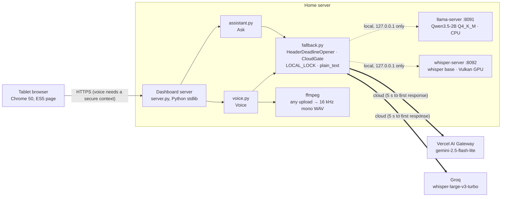
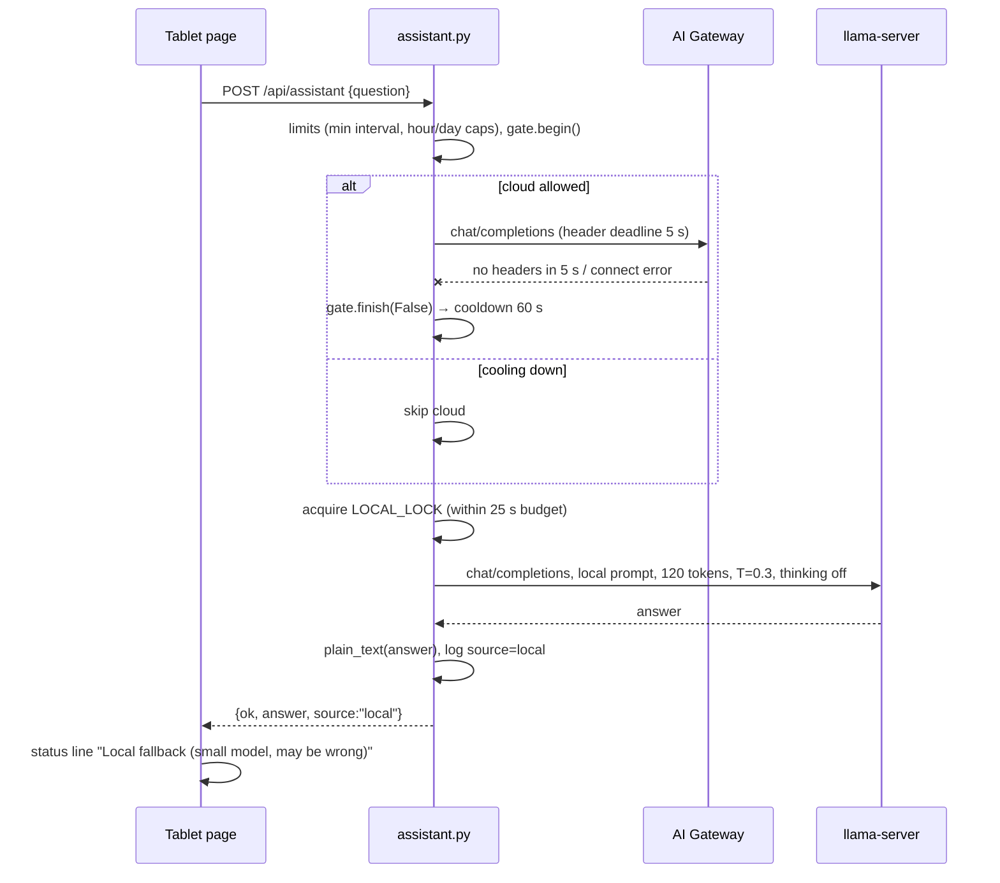

# Local AI Fallback: Architecture

*Project theme: getting the most out of legacy hardware. Nothing here was bought new: the server is a 2014 desktop and the display is an Android 4.4 tablet.*

The tablet dashboard's **Ask** tab (chat) and **Voice** button (speech-to-text) normally use cloud APIs. This subsystem adds small models running on the home server that take over **only when the cloud doesn't respond at all**: the internet is down, DNS is broken, or the provider is unreachable. It runs on a 2014-era desktop with a 2-core i3 and a GTX 745, alongside Plex, Jellyfin and a remote-desktop server.

- Version: introduced in **0.7.0**; the admin page controls and the offline test switch came in **0.9.0** (see `VERSION.md`).
- Status (2026-10-21, version 0.18.0): **live**. The dashboard has run with the fallback enabled since the 0.9.0 restart, and since 0.18.0 the local models start at boot as the systemd user service `tablet-local-ai`. The load tests, the tablet speech set and the tablet end-to-end test are still open (see [Open work](#open-work)).
- Clients: the tablet's classic page sends 16 kHz WAV; since 0.17.0 the phone/PC modern view sends `MediaRecorder` WebM/Opus (MP4 on Safari). Both go through the same `/api/transcribe`, content sniffing and ffmpeg conversion, so the fallback behaves the same for both.
- Measurements and model comparisons: [LOCAL-AI-BENCHMARKS.md](LOCAL-AI-BENCHMARKS.md).
- Original plan and its review: [LOCAL-FALLBACK-PLAN.md](LOCAL-FALLBACK-PLAN.md).

---

## 1. Goals and non-goals

**Goals**
- Keep Ask and Voice answering when the cloud is unreachable, with no extra taps for the user (the tablet's touchscreen is poor).
- Never switch silently: local answers are labelled in the UI.
- Never make a working cloud path worse, except for a hard 5 s limit on *receiving any response*.
- Coexist with the media server: bounded CPU, RAM, VRAM; low priority; loopback-only services.
- Every performance claim backed by a measurement on this machine.

**Non-goals**
- **Not a fallback for every cloud failure.** Exhausted credits (402), rate limits (429), provider errors (5xx) and auth errors (401/403) are *responses*; they keep the normal error messages. This was an explicit product decision: local models cover connectivity loss, not billing or provider problems.
- Not a replacement for the cloud model: a 2B model is right on simple facts most of the time, and wrong on regional facts often enough that the UI says "may be wrong".
- No conversation history, tools or retrieval (same as the cloud path: standalone questions).

---

## 2. Components



| Component | Where | What it does |
|---|---|---|
| `fallback.py` | repo | Shared mechanism: the header deadline, the cooldown gate, the local-inference lock, the markdown/LaTeX cleaner. No I/O of its own besides the cloud request it's handed. |
| `assistant.py` | repo | Ask endpoint. Cloud call via `post_bounded`; on `NoResponse` → `_answer_locally`. |
| `voice.py` | repo | Voice endpoint. Converts audio once with ffmpeg, then the same pattern via `_transcribe_locally`. |
| `web/app.js` | repo | Shows **"Local fallback (small model, may be wrong)"** in the Ask status line when `source == "local"`; voice transcripts get "(local fallback)". |
| `scripts/local-ai-start.sh` / `local-ai-stop.sh` | repo | Start/stop both model servers (pidfiles in `run/`, logs in `logs/`); `scripts/start.sh` calls the start script unless `NO_LOCAL_AI=1`. |
| `tools/eval_local_llm.py` | repo | Repeatable 12-question quality/speed check for any candidate LLM. |
| `local-ai/` | **outside** the repo (sibling directory; absolute path set by `LOCAL_AI_DIR` in the start script) | Pinned llama.cpp / whisper.cpp sources, CPU and Vulkan builds, model files with `SHA256SUMS`, raw benchmark data. Kept out so backups and the public repo copy stay small. |

**Pinned versions:** llama.cpp `b11327` (552f18f), whisper.cpp `v1.9.5` (d1be6fd). Model sources and checksums are listed in the benchmarks doc.

---

## 3. The fallback policy, precisely

A cloud attempt has two phases:

1. **Until response headers arrive.** DNS, TCP connect, TLS, sending the request, and waiting for the status line. If this doesn't finish within `no_response_seconds` (5 s), or fails with a connection-level error (DNS failure, refused, unreachable, reset, TLS error, closed without a status line), the result is `NoResponse`. **This is the only fallback trigger.**
2. **After headers arrive.** Any HTTP status, success or error, is a response. A body that stalls, is cut off, is too large, or exceeds the existing 30 s overall deadline is an ordinary error. **No fallback.**

| Situation | Result |
|---|---|
| Internet down, DNS fails | `NoResponse` in milliseconds → local |
| Provider host unreachable / connection refused | `NoResponse` immediately → local |
| Connection accepted, nothing sent back for 5 s | `NoResponse` at 5.0 s → local |
| 200 OK | cloud answer (`source: "api"`) |
| 401 / 402 / 403 / 429 / 5xx | the same error messages as before this feature |
| Headers received, body stalls | `timeout` error, no fallback |

### Cooldown and probing (`CloudGate`, one per service)

```mermaid
stateDiagram-v2
  [*] --> Normal
  Normal --> Cooling: NoResponse
  Cooling --> Cooling: requests go local, cloud not contacted
  Cooling --> Probing: cooldown (60 s) elapsed, next request
  Probing --> Normal: probe got any response
  Probing --> Cooling: probe got NoResponse
  note right of Probing: only ONE request probes;<br/>concurrent requests stay local
```



- Chat and voice have separate gates: Groq can be down while the AI Gateway is up.
- Time uses `time.monotonic()` under a lock, so wall-clock changes don't affect it.
- Every `begin() == True` is paired with `finish(responded)` in a `finally`, so a probe can't get stuck.

### Why a worker thread for the header deadline

`urllib`'s `timeout` applies to each socket operation. It doesn't bound DNS resolution, and it restarts with every chunk received. `HeaderDeadlineOpener.open()` therefore runs `opener.open(req)` (which returns once headers arrive) in a daemon thread and waits on an `Event` for at most the deadline.
- If the deadline passes, the worker is **abandoned**: it closes any response it later receives.
- **At most one abandoned worker per service**: while it's still alive, new attempts count as `NoResponse` immediately instead of piling up threads. In practice the cooldown already keeps requests away from the cloud for 60 s.
- The worker's own socket timeout is the service's overall `timeout_seconds` (30 s), so a straggler always dies.

### Concurrency and CPU protection

- Each service already allows one request at a time (`_inflight` lock; busy → 429).
- `fallback.LOCAL_LOCK` is shared by chat and voice: **only one local model runs at a time**, because the CPU has two physical cores and Plex needs them too. Waiting for the lock counts against the local deadline (`acquire_local(deadline)`).
- Both model servers run under `nice -n 10`, with 2 threads (measured faster than 4), `--parallel 1`.

---

## 4. Request flows and time budgets

### Ask (chat)



### Voice

Upload → content sniffing → ffmpeg to 16 kHz mono WAV (once) → cloud (5 s header deadline) or local `POST /inference` with `language=auto`, `response_format=verbose_json` → the same `_parse` as the cloud path (drops punctuation-only or high `no_speech_prob` "transcripts") → the page fills the question box and, with `auto_ask`, asks immediately.

### Worst-case budgets (enforced server-side)

| Path | Phases | Server worst case | Page timeout | Margin |
|---|---|---|---|---|
| Ask, cloud slow but answering | body ≤ 30 s, no fallback | 30 s | 45 s (`AI_TIMEOUT_MS`) | 15 s |
| Ask, fallback | 5 s no-response + ≤ 25 s local (lock wait included) | 30 s | 45 s | 15 s |
| Voice, any path | everything capped by `total_timeout_seconds` = 45 s (conversion, then cloud or local gets the remainder) | 45 s | 60 s (`VOICE_TIMEOUT_MS`) | 15 s |

**Measured** (details in the benchmarks doc): with the cloud black-holed, Ask took **8.0 s** (5.0 s wait + 3.0 s local), then **~1.8 s** per question during the cooldown. Voice took **12.0 s** the first time (including a 4.0 s cold start of the snap-packaged ffmpeg), then **3.2–3.5 s**.

---

## 5. Local model configuration

| Setting | Value | Why |
|---|---|---|
| Chat model | **Qwen3.5-2B, Q4_K_M** (unsloth GGUF, 1.28 GB) | Best accuracy of six candidates at usable speed; Q8_0 was no more accurate and 30–45% slower. See benchmarks. |
| Chat backend | CPU, 2 threads | On the GTX 745 via Vulkan it was slower (9.4 vs 11.3 tok/s). |
| Speech model | whisper.cpp `ggml-base` (multilingual, 148 MB) | Spanish and English with auto-detect. |
| Speech backend | **Vulkan on the GTX 745** | ≈ 2.0 s per clip vs ≈ 5 s on CPU, identical text, ≈ 315 MiB VRAM. |
| Local system prompt | `assistant.LOCAL_SYSTEM_PROMPT`: one or two short sentences, question's language, plain text only, admit uncertainty | The cloud prompt's "you have no access to live weather…" line made small models refuse plain facts (Gemma: "I cannot tell you the capital of France"). |
| Sampling | `temperature` 0.3 (`LOCAL_TEMPERATURE`), `max_tokens` 120, `chat_template_kwargs.enable_thinking=false` | Accuracy was best at low temperature; 120 tokens ≈ 11 s worst case at 11 tok/s, inside the 25 s budget. |
| Output cleaning | `fallback.plain_text()` | Strips `**bold**`, `*italic*`, headings, inline code, `$…$` LaTeX (with `\times`, `\frac`, `^\circ`…), turns bullets into "•". Leaves prices such as "$5" alone. |
| llama-server flags | `-c 2048 -t 2 --parallel 1 --jinja --no-webui --cache-ram 256` | `--cache-ram` matters: the prompt cache defaults to **8 GiB** and grew RSS from 1.9 to 2.6 GB during tests. |
| whisper-server flags | `-t 2 -l auto` | Full 30 s audio window kept (shrinking it dropped words, see benchmarks). |
| Warm-up | the start script sends one sample clip to whisper-server | The first request after start is slow (CPU ≈ 9.5 s; Vulkan ≈ 11 s while the driver compiles shaders). |

Resident memory with the shipped settings: llama-server **≈ 1.9–2.0 GB** (flat), whisper-server **≈ 0.2 GB** RAM + **≈ 0.3 GB** VRAM.

---

## 6. Interfaces

### HTTP responses (additions only)

```jsonc
// POST /api/assistant, success
{"ok": true, "answer": "…", "truncated": false, "remaining": {…}, "source": "api" | "local"}
// POST /api/transcribe, success
{"ok": true, "text": "…", "no_speech": false, "seconds": 4.5, "remaining": {…}, "source": "api" | "local"}
// both, when the cloud didn't respond AND the local model failed (503)
{"ok": false, "error": {"code": "local_unavailable", "message": "The AI service didn't respond and the local fallback is unavailable."}}
// … or, during the cooldown, "Using the local fallback (the AI service was unreachable a moment ago), but it is unavailable right now. Try again shortly."
```

`GET /api/assistant/status` and `/api/voice/status` gain `"fallback": {"enabled": true, "cloud_cooling_down": false}`.

### Usage log fields (`data/*-usage.jsonl`, one JSON line per request)

| Field | Values |
|---|---|
| `source` | `api` / `local` |
| `cloud` | `no_response` (tried, nothing came back) / `skipped` (cooldown) |
| `outcome` | adds `success_local`, `no_speech_local`, `local_error` |
| `local_error` | the failure category, e.g. `network_error`, `timeout`, `local_busy` |
| `api_wait_ms`, `local_ms`, `convert_ms` (voice), `duration_ms` | phase timings for latency analysis |
| `estimated_cost_usd`, `reported_cost_usd` | `null` for local answers |

Local answers count toward the same per-hour and per-day caps (they protect the server too).

### Configuration (`config.json`, sections `assistant` and `voice`; all optional)

The config loader merges only one level deep, so these are **flat keys**. A nested `fallback` object would be replaced wholesale by any partial override.

| Key | assistant default | voice default | Valid range |
|---|---|---|---|
| `fallback_enabled` | `true` | `true` | bool |
| `fallback_base_url` | `http://127.0.0.1:8091/v1` | `http://127.0.0.1:8092` | **http on loopback only** (validated) |
| `fallback_model` | `qwen3.5-2b` | `whisper-base` | label for logs; llama-server ignores it |
| `fallback_max_output_tokens` | `120` | — | 16–4096 |
| `fallback_timeout_seconds` | `25` | `20` | 1–120 |
| `no_response_seconds` | `5` | `5` | 0.1–60 (capped at `timeout_seconds`) |
| `cloud_cooldown_seconds` | `60` | `60` | 0–3600 |
| `total_timeout_seconds` | — | `45` | 5–300 |

Since 0.9.0 the admin page's **AI models** page edits these keys live, with no restart. It also sets the cloud model and token limit.

**Which local model runs** (`config.json` section `local_ai`, since 0.9.0, edited from the admin page; `localai.py`):

| Key | Default | Notes |
|---|---|---|
| `llm_model` | `Qwen3.5-2B-Q4_K_M.gguf` | a `*.gguf` file name in `local-ai/models/` (no paths; traversal is rejected) |
| `llm_backend` | `cpu` | selects `build/llama-<backend>/` |
| `stt_model` | `ggml-base.bin` | a `ggml-*.bin` file name in `local-ai/models/` |
| `stt_backend` | `vulkan` | selects `build/whisper-<backend>/` |
| `threads` | `2` | 1–16 |

`scripts/local-ai-start.sh` reads them through `python3 localai.py env`. Start-script environment variables still override them: `LOCAL_AI_DIR`, `LOCAL_AI_LLM` (model path), `LOCAL_AI_STT`, `LOCAL_AI_LLM_BACKEND`, `LOCAL_AI_STT_BACKEND` and `LOCAL_AI_THREADS`. The values are read as data and never evaluated. The admin page refuses a model larger than the free RAM. Swapping a model restarts that server, and the fallback is unavailable for about 10–30 s while it does.

---

## 7. Security and safety

- Both model servers bind to **127.0.0.1** only; the dashboard is the only client. `fallback_base_url` is rejected at startup unless it is plain http on a loopback address.
- The cloud API key is **never sent to the local servers** (tested: the mock local server asserts no `Authorization` header).
- Local responses go through the same size-bounded reader (`post_bounded`) and parser as cloud responses; answers are rendered as text, never HTML.
- Model files are verified against the publisher's sha256 (`local-ai/models/SHA256SUMS`); upstream sources are pinned to exact tags.
- The stop script only signals PIDs whose command line matches the expected binary.

---

## 8. Testing

**Automated** (`python3 -m unittest discover -s tests`; 182 tests at 0.9.0, about 2¼ min; `tests/test_fallback.py` has 23, and the netsim tests are listed below). All network traffic goes to local mocks with dummy keys.
- **Mock servers:** a **black hole** that accepts TCP and never sends; a closed port; a server that sends headers then stalls; mock llama-server and whisper-server.
- **Covered:**
  - The deadline fires at ≈ 0.5 s in tests; refused connections fall back in under 0.5 s.
  - Every HTTP error class does **not** fall back.
  - A stalled body does not fall back.
  - The cooldown skips the cloud, and exactly one probe goes out afterwards.
  - The straggler limit holds.
  - The two "local unavailable" messages appear in the right situations.
  - The lock wait is bounded.
  - The voice 45 s cap holds.
  - The local request has no key, temperature 0.3, 120 tokens, and the local prompt.
  - Markdown and LaTeX cleaning works on known cases and leaves ordinary text untouched.
  - Loopback-only URL validation.
- The older test suites set `fallback_enabled=False` so they can never reach a real local server running on the machine.

**Live, without touching production:** run a second `server.py --config <test.json>` on a spare port with:
- a **dummy-key** env file and test-only state/log paths;
- the cloud `base_url` pointed at a local black-hole socket (a few lines of Python: `accept()` and never reply).

The real local models answer, so this measures true end-to-end latency. Never point the real key at a test address.

**Offline test switch (since 0.9.0, `netsim.py`):** simulates an outage **inside the dashboard process only**. The rest of the server keeps its real network: no iptables, no routing changes. Turn it on from the admin page's **Offline test** page or with `scripts/offline-test.sh on [ask,voice,weather,maps,calendar] [minutes] | off | status`. The state lives in `data/offline-test.json` and is re-read when its mtime changes, so the page and the script stay in sync.
- **Realistic** mode (the default): `HeaderDeadlineOpener.open` keeps its worker thread, but the worker sleeps for the socket timeout instead of connecting. The real 5 s deadline, the straggler guard and the cooldown-then-single-probe therefore run exactly as in a real outage.
- **Instant** mode raises `NoResponse("simulated")` straight away. It tests the local path and the label without the 5 s wait.
- Weather, maps and calendar fetches can be included, to see the tablet's stale and unavailable states.
- It always expires: 15 min by default, at most 120. Any switch-off, whether from the admin page, the script or the timer, resets both `CloudGate`s (`CloudGate.reset()`), so the next request uses the cloud again immediately.
- While it is on, usage entries get `"simulated": true`, the admin page shows a red countdown banner, `/api/config` reports `offline_test`, and the tablet shows a red **OFFLINE TEST** tag. A test can never be mistaken for a real outage.
- The admin page's **Fallback test** button runs one Ask and one Voice round trip and reports which side answered, with timings.
- Tests: `tests/test_netsim.py` covers expiry, parsing, instant mode, realistic mode hitting a short deadline, and the gate reset.

**Model quality:** `tools/eval_local_llm.py --runs 3 --out results.json` against any OpenAI-compatible server. The admin page's **Test local** button sends one sample straight to :8091 or :8092 for a quick comparison.

---

## 9. Decisions log

| # | Decision | Alternatives considered | Reason |
|---|---|---|---|
| 1 | Fall back only on "no response headers in 5 s / connection failure" | Fall back on any error; on 402/429 too | The product owner's rule: local is for connectivity loss. It keeps billing and quota problems visible instead of hiding them behind a weaker model. |
| 2 | Header deadline in a worker thread | Socket timeout only | A socket timeout doesn't bound DNS and restarts on every chunk; it can't express "no response in 5 s". |
| 3 | 60 s per-service cooldown, then a single probe | Retry the cloud on every request | Without it, every request during an outage pays the 5 s wait; a single probe avoids a burst of probes. |
| 4 | One local model at a time (shared lock) | Let chat and speech run concurrently | 2 physical cores shared with Plex; concurrency would slow both and the media server. |
| 5 | Qwen3.5-2B Q4_K_M | Qwen3 0.6B, Qwen3.5 0.8B, Gemma 3 1B, Qwen3.5-2B Q8_0 | 30/33 on the eval vs 21–24/33 for the small models; Q8_0 equally accurate but slower. |
| 6 | LLM on CPU, Whisper on GPU (Vulkan) | All CPU; all GPU; CUDA | Measured: Vulkan slowed the LLM but made Whisper ≈ 2.5× faster. CUDA skipped: Maxwell (sm_50) has neither fast fp16 nor dp4a, so llama.cpp's fast quantized kernels don't apply. |
| 7 | 2 threads | 4 threads | 2 measured as fast or faster for every model (generation is memory-bandwidth bound; hyper-threads add contention) and leaves headroom for Plex. |
| 8 | Separate short plain-text local prompt + `plain_text()` | Reuse the cloud prompt | The cloud prompt caused refusals and long markdown/LaTeX answers. The tuned prompt halved answer time and removed all formatting. The cleaner stays as a safety net. |
| 9 | Full 30 s Whisper window, auto language | `audio_ctx` sized to the clip; fixed language | Smaller windows dropped words or made the decoder loop; the user speaks both Spanish and English. |
| 10 | `--cache-ram 256` | Default (8 GiB) | The default prompt cache grew llama-server by ~0.7 GB during tests on a shared 16 GB machine. |
| 11 | Binaries/models outside the repo, pinned tags, sha256 | System packages / latest builds | Reproducible; large files out of backups and the public repo. |
| 12 | Flat config keys | Nested `fallback` object | One-level config merge would drop unspecified nested defaults. |
| 13 | Local answers count toward usage caps | Exempt them | Simpler, and the caps protect the server's CPU too. |

---

## 10. Pitfalls found while building (read before changing things)

- **`pkill -f` / `pgrep -f <pattern>` kills your own shell** when the pattern appears in the command line that runs it. Stop processes by pidfile or by the listening port (`ss -ltnpH "sport = :PORT"`).
- **`setsid cmd &` may fork**, so `$!` isn't the server's PID. The start script uses `setsid nohup nice … &` from a non-interactive script, where the exec chain keeps the PID; verify with `/proc/<pid>/cmdline`.
- **The snap ffmpeg** can only read non-hidden paths under `$HOME` (the voice temp dir lives in `data/`), and its first start can take ≈ 4 s.
- **First Whisper request after start is slow** (shader compile on Vulkan); the start script warms it up.
- **llama-server's prompt cache defaults to 8 GiB**: keep `--cache-ram`.
- Run tests with `discover -s tests` (test modules import each other from that directory). `test_voice.test_rejected_input_uses_no_quota` sometimes fails with a `BrokenPipeError`, depending on timing. The likely cause is that the server rejects the upload before the client has finished sending it. It fails the same way on the pre-admin snapshot, so it predates 0.9.0. Full runs usually pass.
- llama.cpp build warnings "OpenSSL not found" and a failed web-UI download are harmless here (loopback HTTP, `--no-webui`).
- A model saying it "can't access real-time information" usually means the system prompt mentions live data. Keep that sentence out of the local prompt.

---

## 11. Operations

Since 0.18.0 the models normally run as the systemd user service `tablet-local-ai` (a oneshot unit around the two scripts below), started at boot. The scripts still work directly and are what the unit and the admin page call; they keep their own pidfiles, so starting twice is harmless.

```bash
systemctl --user status tablet-local-ai   # boot-time unit (active = the start script succeeded)
systemctl --user restart tablet-local-ai  # stop + start both models through the unit
scripts/local-ai-start.sh          # starts both servers (idempotent), health-checks, warms up whisper
scripts/local-ai-stop.sh           # stops them by pidfile, verifying the command line
scripts/start.sh                   # dashboard; also starts local AI unless NO_LOCAL_AI=1
scripts/offline-test.sh on ask,voice 15   # simulate an outage for Ask and Voice (dashboard only), auto-off in 15 min
scripts/offline-test.sh off
LOCAL_AI_STT_BACKEND=cpu scripts/local-ai-start.sh       # run whisper on CPU instead
LOCAL_AI_LLM=/path/to/other.gguf scripts/local-ai-start.sh  # try another LLM
python3 tools/eval_local_llm.py --runs 3                  # quality check of whatever is on :8091
curl -s http://127.0.0.1:8091/health                      # {"status":"ok"}
nvidia-smi --query-compute-apps=pid,process_name,used_memory --format=csv   # whisper-server ≈ 315 MiB
```

The admin page (`https://<server>:8443/admin`, **AI models** page) covers the same ground in the browser: model and backend choice, start/stop/restart, health, PID and RAM per server, and the last log lines. Models restarted from the admin page run in the dashboard service's cgroup; its `KillMode=process` makes sure a dashboard restart never takes them down.

Logs: `logs/llama-server.log`, `logs/whisper-server.log`. Usage: `data/assistant-usage.jsonl`, `data/voice-usage.jsonl` (filter `"source":"local"`).

**Rebuilding** (in `local-ai/`): `cmake -S src/llama.cpp -B build/llama-cpu -DCMAKE_BUILD_TYPE=Release -DGGML_NATIVE=ON -DLLAMA_CURL=OFF`, then `cmake --build build/llama-cpu -j 3 --target llama-server llama-bench`. Add `-DGGML_VULKAN=ON` for `build/*-vulkan` (needs `glslc libvulkan-dev spirv-headers`). The same pattern applies to whisper.cpp (`--target whisper-server whisper-cli whisper-bench`).

---

## Open work

1. ~~Enable in production~~: done with the 0.9.0 restart (2026-10-19).
2. **Under load:** repeat the benchmarks while Plex/Jellyfin stream (and transcode on the shared GPU); confirm no stutter and that NoMachine stays responsive.
3. **Speech set:** about 12 clips recorded on the tablet (Spanish/English, short/long, names, silence, background noise, TV). Compare with Groq's transcripts and confirm silence/noise produce no text. If base fails, try whisper `small` on the GPU.
4. **Tablet end to end** over HTTPS, with the fallback forced by the offline test switch (Realistic mode, Ask and Voice); measure tap-to-answer.
5. Investigate ≈ 0.9 s of overhead between whisper-server alone (≈ 2.0 s) and the dashboard's local voice phase (≈ 2.9 s); `verbose_json` output is the first suspect.
6. Reduce the ffmpeg cold start (keep it warm, or use a non-snap ffmpeg).
7. ~~Autostart (systemd)~~: done in 0.18.0 (2026-10-21) for both the dashboard and the local models. Still to confirm through a real reboot.
8. Optional: a tiny local facts file (city distances, capitals of the region) in the prompt would fix the most visible wrong answers.
