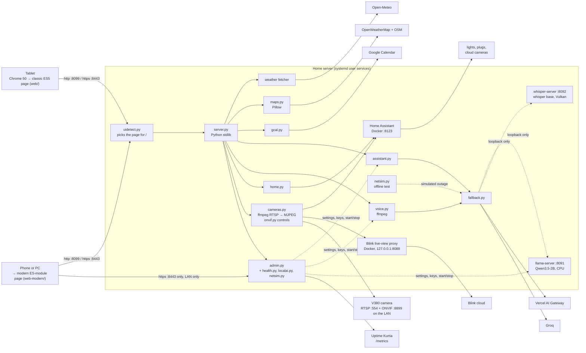

# Tablet Dashboard: System Overview

An old Android tablet repurposed as an always-on home dashboard: clock, weather, weather maps, a calendar agenda, an AI assistant you can ask by voice, Home Assistant controls, security cameras and an uptime board. A small Python server on a home Linux box does all the work. The tablet only displays a web page. Since 0.15.0 the same address also gives phones and PCs a modern, responsive version of every section.

*Updated 2026-10-22 for version 0.21.2.*

Details live elsewhere: configuration, routes and the admin page in the [README](../README.md); admin internals in [ADMIN-PANEL.md](ADMIN-PANEL.md); local AI in [LOCAL-FALLBACK-ARCHITECTURE.md](LOCAL-FALLBACK-ARCHITECTURE.md) and [LOCAL-AI-BENCHMARKS.md](LOCAL-AI-BENCHMARKS.md).

---

## 1. Goal

Give a drawer tablet a second life as a useful wall/desk display that:

- runs all day without anyone touching it,
- needs as few taps as possible (the touchscreen is unreliable),
- uses free API tiers and existing hardware, with no new spending,
- doesn't disturb the media services already running on the home server,
- keeps working, with reduced quality, when the internet is down.

## 2. The hardware

| | Tablet (display) | Home server (backend) |
|---|---|---|
| Device | Android 4.4.2, ARMv7 Cortex-A7, 1 GB RAM, 800×400 screen | Ubuntu 24.04, Intel i3-4150 (2 cores, 2014), 16 GB DDR3 |
| GPU | none | NVIDIA GTX 745, 4 GB DDR3 (H.264 only, no HEVC) |
| Browser | Chrome 50 (2016) | n/a |
| Other duties | none | Plex, Jellyfin, Docker, Samba, qBittorrent, NoMachine |

Phones and PCs on the home network are extra clients. They get the modern view (section 4) and need no setup beyond the address.

## 3. Features

| Tab / feature | Source | Notes |
|---|---|---|
| Clock | server time | Driven by the server, in the configured time zone, with a 12h/24h toggle |
| Weather | Open-Meteo (no key) | Cached server-side and refreshed every 15 minutes; marked stale after 35 minutes |
| Weather maps | OpenWeatherMap tiles + OpenStreetMap base | Precipitation, clouds, wind and temperature layers, composited with Pillow and rotated every 10 seconds |
| Calendar | Google Calendar API, read-only | OAuth desktop flow; the token stays on the server |
| Ask | Vercel AI Gateway → `gemini-2.5-flash-lite` | Standalone questions, no history; answers shown in large text, one page at a time |
| Voice | Groq `whisper-large-v3-turbo` | One tap records, silence ends the recording, then the question is asked automatically |
| Local fallback | Qwen3.5-2B on CPU, whisper base on GPU | Takes over Ask and Voice only when the cloud doesn't respond at all |
| Admin page | `https://<server>:8443/admin`, LAN only | Password sign-in; API keys, AI models (cloud and local), Google sign-in, health and Uptime Kuma, settings, logs, maintenance, offline test switch |
| Home | Home Assistant (your own, e.g. in Docker) + optional media switch | One tile per light/plug (ON/OFF, one tap); optional Plex/Jellyfin switch with confirm (0.12.0) |
| Cameras | Blink via Home Assistant (+ a local Blink live-view proxy); V380 over local RTSP and ONVIF | **Blink:** latest snapshot per camera, New snapshot, motion pop-up from any tab; arm/disarm and motion tiles on Home (0.13.0); optional on-demand live view through a Blink live-view proxy you run yourself (0.21.0). **V380:** live view that works without internet, ffmpeg running only while someone watches (0.14.0); pan/tilt arrows, HD/SD and Day/Night/Auto over ONVIF (0.19.0); found again by its MAC if its address changes (0.20.0) |
| Uptime | Health checks + Uptime Kuma (`/metrics`) | Kuma monitors first, then the home services you configure (media server, file share…), problems first, with ping and a short history (0.11.0). The public snapshot (`/api/uptime`) carries no hostnames or error details |
| Navigation | n/a | Big Back/Next buttons and a full-screen "Go to" grid instead of small tabs, for the worn touchscreen (0.10.0) |
| Modern view | same `/api/*` routes | Phones and PCs get an ES-module page at the same address: Overview grid on a PC, tab bar on a phone, light/dark, camera pages, motion banner, one-tap voice with `MediaRecorder` (0.15.0–0.17.0). The classic view's Go to menu has a Modern view button (0.21.1) |
| Autostart | systemd user services | The dashboard and the local models start at boot; the dashboard restarts 5 s after a crash (0.18.0) |

## 4. Architecture

- **Backend:** Python 3 standard library, plus Pillow for the maps. There are no frameworks and no build step. Each integration is one module.
- **Two front ends, one API:** `GET /` sends the classic page (`web/`, ES5) to old browsers such as the tablet's Chrome 50 and the modern page (`web-modern/`, ES modules, served under `/m/`) to everything else. `uidetect.py` decides from the User-Agent, with `?ui=classic|modern|auto` and a `ui` cookie as overrides; a modern page that can't run falls back to classic by itself. Both pages use the same `/api/*` routes, so new features never have to hold back the old page and phones never have to run the tablet's constrained layout. Neither uses `innerHTML` or inline script (strict CSP).
- **Process management:** two systemd *user* services (lingering on, so no login is needed): `tablet-dashboard` (`Restart=always`, 5 s) and `tablet-local-ai`. `scripts/start.sh` and `stop.sh` call `systemctl --user` when they are installed (`scripts/install-autostart.sh`).
- **Secrets:** stored only in `.env` (mode 600). They are never sent to the browser, never kept in config, and never committed.
- **State:** usage counters, cached map images, the calendar token, the admin password hash (`data/admin.json`, scrypt) and the offline test state live in `data/` (mode 700).
- **Admin:** one admin, with in-memory sessions (a restart signs you out). The page is served only on https and only to LAN clients; on http, or from outside the LAN, `/admin` returns 404.

## 5. Constraints and how they were worked around

### Old tablet, old browser

| Constraint | Workaround |
|---|---|
| Chrome 50 on Android 4.4: no ES6 modules, no `fetch` guarantees, no `MediaRecorder`, no promise-based `mediaDevices` | The page is written in ES5. Voice uses `webkitGetUserMedia` and a Web Audio `ScriptProcessor`, then encodes 16 kHz WAV in JavaScript. |
| Phones and PCs deserve a modern layout, but one code base would stay stuck at ES5 | A second page for modern browsers, picked per request from the User-Agent. The server sniffs uploaded audio, so the WAV from the tablet and the WebM/MP4 from `MediaRecorder` go through the same `/api/transcribe`. |
| 1 GB RAM and a weak CPU | All heavy work happens on the server. The tablet gets finished JSON and ready-rendered PNG maps instead of a live map library. |
| Microphone access only works on https | A second https listener on :8443 uses a self-signed certificate from a private CA (`scripts/make-cert.sh`). |
| Installing a CA on Android 4.4 forces a screen-lock PIN | The CA is deliberately not installed. The "Not secure" warning is accepted, and fullscreen hides it. |
| Poor touchscreen | Voice takes one tap: noise is calibrated, recording stops on silence, and the question is asked automatically. Buttons are large, and long answers are paged with big Back/Next buttons instead of scrolling. |
| Washed-out LCD at 800×400 | Map base tiles are darkened with strong contrast and saturation. There is a separate small-viewport layout. |
| The tablet's clock may drift or have the wrong timezone | The server provides the time (`/api/time`), and the page only offsets from it. |

### Free tiers and cost

| Constraint | Workaround |
|---|---|
| Open-Meteo free tier is non-commercial, CC BY 4.0 | One server-side fetch every 15 minutes (about 96 calls a day) shared by every viewer, with the required attribution link shown. |
| OpenWeatherMap: 60 calls a minute | Self-limited to 30 a minute, refreshed every 30 minutes. Base tiles are fetched once and cached. |
| AI Gateway free credits; buying credits ends the free tier | One fixed model, `max_tokens` capped, reasoning off, at most 20 requests an hour and 100 a day, and one request at a time. Billing is never touched. |
| Groq: 20 requests a minute and a 10 s billing minimum per clip | Clips at least 5 s apart, 60 an hour, 300 a day, and 30 s each at most. Silence detection sends nothing if nobody speaks. |
| Google OAuth in Testing mode expires tokens after 7 days | Reconnecting takes a few clicks on the admin page's Calendar page, which shows the token's age. The longer-term fix is to publish the app "In production" (unverified is fine for personal use). Device flow can't be used because Google doesn't allow Calendar scopes on it. |

### Shared, aging home server

| Constraint | Workaround |
|---|---|
| Plex, Jellyfin and others already use the box | Python stdlib only and one process. Local models run under `nice -n 10`, with 2 threads and one request at a time. A single shared lock means only one local model ever runs at once. |
| Storage disks are full | Everything is written to the root filesystem. Model files and builds sit outside the project folder. |
| GTX 745: old Maxwell, DDR3 VRAM, no fp16 math | Measured rather than assumed: the GPU made the LLM *slower* (9.4 vs 11.3 tok/s) but Whisper about 2.5× faster. So the LLM runs on the CPU and Whisper on the GPU. |
| CPU text generation is limited by memory bandwidth (DDR3-1600) | Chose a 2B Q4_K_M model as the best trade-off: 30/33 on the quality check at about 11 tok/s. Smaller models were faster but failed regional and arithmetic questions. |
| The snap build of ffmpeg can only read non-hidden paths under `$HOME` | Audio conversion happens in `data/voice-tmp`. |
| The previous test server exposed the whole home directory to the LAN | Replaced. Only `web/` and `media/` are served, with strict checks against path traversal and symlinks escaping those folders. |

### Reliability

| Constraint | Workaround |
|---|---|
| Internet or DNS outages | The local fallback takes over when no response headers arrive within 5 s (`HeaderDeadlineOpener`). After that, a 60 s cooldown and a single probe request decide when to return to the cloud. Chat and voice track this separately. |
| A fallback shouldn't hide billing or provider problems | Any HTTP response, including 401, 402, 429 or 5xx, keeps its normal error message. Only *no response at all* switches to the local models. |
| Local answers are less reliable | They are labelled "Local fallback (small model, may be wrong)" on screen. |
| `urllib` timeouts don't cover DNS and restart with every chunk received | The cloud request runs in a worker thread with a hard deadline. At most one abandoned worker is allowed per service. |
| Fallbacks are hard to test without breaking the house's internet | The offline test switch simulates an outage inside the dashboard only, expires on its own, and is clearly labelled on the tablet and in the logs. |
| Nothing watched whether services were up | The admin page checks every 60 s: the listeners, data freshness, keys, local models, disk, the certificate, Plex/Jellyfin/Samba and more, with optional Uptime Kuma monitors and about 24 h of history. |
| External APIs can be slow or return huge responses | Every fetch has a timeout, a response size cap, and no redirects while credentials are attached. The UI shows stale or unavailable states. |
| A reboot left the dashboard down until someone noticed (2026-10-21) | systemd user services start everything at boot, and the dashboard restarts 5 s after a crash (tested with `kill -9`: back in 6 s). |

### Cameras

| Constraint | Workaround |
|---|---|
| The tablet's Chrome 50 can't be relied on to play live H.264 | The server turns each stream into MJPEG, which a plain `` shows. |
| Live video is expensive on a 2-core CPU | One ffmpeg per camera and quality, started only while someone watches, shared by every viewer, stopped 15 s after the last one leaves; pages drop the stream when hidden or after `live_max_seconds`. Measured: V380 SD (640x360) about 10% of one core, HD (1280x720) 14-19%, Blink at 720p about 27%. |
| A camera can get a new DHCP address after a restart, which breaks live view | Give it a static address or a DHCP reservation. Since 0.20.0 the dashboard also finds it again by MAC (ONVIF WS-Discovery) if it ever moves, and logs a warning to update `config.json`. |
| A V380 can keep a stale DNS server from an earlier network, so its app shows it offline and its NTP clock drifts | ONVIF `SetDNS` (unauthenticated on the V380) fixes it without the app; check the on-screen clock after daylight-saving changes. |
| The V380 has no password option for RTSP or ONVIF | Keep it LAN-only: no port forwarding, and UPnP off on the router. Anyone on the same network can watch it or move it; a separate SSID only helps if it is really a separate subnet. |
| Each Blink live view is a cloud session, and the proxy allows a new one only about 30 s after the last | Blink live starts only on a tap. Leaving, changing tabs or hiding the page stops it and forgets it, so a woken screen doesn't start a new session. |
| ffmpeg error messages quote the URL, and those messages reach the page | The Blink proxy token goes in an `Authorization` header, never in the URL. |

## 6. Current status (version 0.21.2)

- **Working:** every section on the old tablet (clock, weather, maps, Home, Cameras with RTSP live view and ONVIF controls, Calendar, Uptime, Ask, one-tap Voice over https), the modern view for phones and PCs, the local AI fallback, the admin page, and autostart with crash recovery.
- **Not yet measured or verified:** the fallback under a media-server stream, real tablet microphone recordings in noisy rooms, the modern view on a range of real phones, and a full reboot cycle with autostart.
- **Planned:** sound for RTSP live view (the camera's audio as a separate stream), recording RTSP cameras to disk, kiosk mode, admin alerts (ntfy or email), and an authenticated way to reach the dashboard from outside the LAN.
- **If you use Google Calendar:** while your Google Cloud app is in Testing, the sign-in expires every 7 days. Publish the app ("In production"; unverified is fine for personal use), or reconnect from the admin page.
